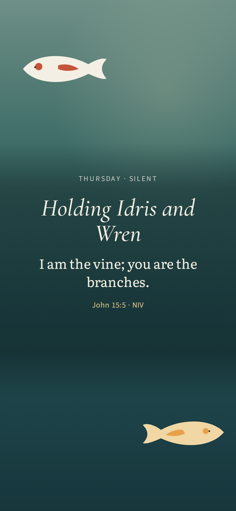
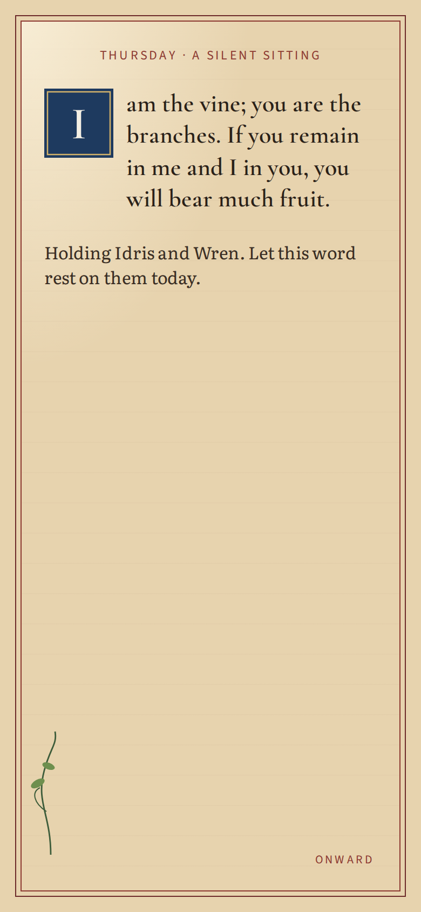
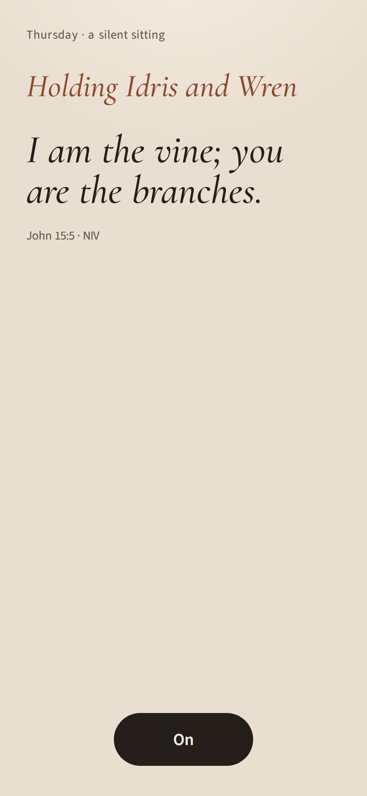

# Design direction: entry A

Written before product code.

## What we found (discover)

Protected:

- **The memory puzzle.** It is the thing the children ask to repeat. The default cut leaves most of the verse standing and lets the loose words fall. No score.
- **One weekly passage, prayed by name.** The household already understands a pair a day and everyone on Sunday. The change of passage is a small surprise the children like.
- **Prayer as still type.** Large serif type, one thought, then a tap. Koi behind the words would undo the reason the prayer page exists.
- **The pond's idea, not its chrome.** A living creature in water, fed by hand, is the glance. Four labelled zones, settings, and a "running lean" gauge are not.
- **Hand-made warmth.** Paper, water, weight. Not a component library.

Broken, and not carried forward:

- One "prayed today" flag, so a morning Amen finishes the day before the children arrive.
- The verse the children learn has names and a shifting register inside it. The NIV lines and the paraphrase are not the same words.
- The week turns seven days after the rota was created, not on Monday. Sunday does not close the week. Copy says "this morning" at night.
- Confession is a physics toy. The adult can clear it without reflecting. The names on the stones (greed, selfishness) do the work a question should do.
- Six hard-coded people, a personal board on the family screen, and a front door made of URLs.
- Options, labs, celebration settings, murmuration, and a second vine product. None of them is the daily choice.

## Research

| Source | What we take | What we reject |
|---|---|---|
| Lectio Divina | One passage, read until it is the only thing on the page, then a response. | A commentary stack under the reading. |
| Praying Scripture | Names belong in the prayer around a stable verse. | Rewriting the verse each day so there is nothing solid to learn. |
| The Jesus Prayer / breath prayer | One line, silence, no timer. The morning is silent. | A breathing game during the verse. |
| Ignatian Examen | One honest look: what got in the way. Then stop. | A dashboard of the day. Scoring the conscience. |
| Comer, *Practicing the Way* | A rule of life is a few words you actually live, reviewed when the season changes, not a feed. | Turning the rule into tasks with completion percentages. |
| Godly Play | "I wonder", and a real object a child can move. Silence is an answer. | Quizzing. Clever mechanics nobody is told. |
| Lectio 365 / Lectio for Families | The same shape every day, short enough to finish. | A ten-minute script and a content library. |
| Pray as you Go | A threshold, then one passage, then stop. | Music and a synthetic voice. Sound is out this round. |
| Hallow | Craft and an ending. | Streaks, guilt, a catalogue. |
| Duolingo | Retrieval: the words leave and the child puts them back. | XP, leagues, hearts, "you missed yesterday". |
| Headspace | One session. The screen after the session is quiet. | Courses, minutes-meditated trophies. |
| Alto's Odyssey, Monument Valley, Sky | The place is calm, the picture is the interface, you leave when the moment is over. | Endless play after the prayer. |
| Humane technology | The app should finish. No pull back. | Notifications, infinite home, shame for a gap. |

### Visual craft

References inform the three directions. Nothing below is copied: no character, no print, no brand.

| Reference | What we take | What we refuse |
|---|---|---|
| Lisbeth Zwerger's picture books | A large quiet page. The words are the event. | Her figures, her line. |
| Brian Wildsmith's illustrated Bible | Flat colour, and gold used as honour, once. | The density. A prayer cannot be a full picture. |
| Eric Carle's painted paper | Puzzle slips feel cut, with a soft edge, not like interface chips. | The caterpillar palette. |
| Japanese woodblock water | The glance: water as a few flat bands, a fish as a few shapes. | Any particular print. |
| Anni Albers' weavings | The weeks are a row of threads you can read, not a chart. | A pattern for its own sake. |
| Makoto Fujimura | Gold is contemplation. The ground is quiet. | The look of a specific painting. |
| Alto's Odyssey | 06:45 is dim and warm, one body in a large world. Dawn is not noon-white. | Endless glide after the prayer. |
| Monument Valley | Flat colour, no noise texture, the picture is the control. | Impossible architecture, pastel UI. |
| Gorogoa | You touch the picture itself: a stone, a fish, a word. | Its panels and its puzzles. |
| Journey | One warm light, then the experience ends. | Cloth collectibles, a hub. |

**Type.** Literata (TypeTogether) is for the prayer: it was made for long reading on a screen, with a large x-height. Cormorant Garamond italic is only for the verse, and only at a large size. Its thin strokes fail as small text and as a paragraph, and they fail at night if the line is small, so the verse stays large when the lamp is down. Source Sans 3 is for labels and buttons. A 7-year-old gets short lines, roman letters, and no sentence in capitals. The puzzle slips are Literata roman, because matching a word is a reading task and italic is slower. Night type is `#f3eadc` on `#161c28`, not white on black, so the letters do not bloom.

**Colour.** Day paper `#efe6d6`, ink `#241f1a`, about 13:1. The 06:45 tile is the same palette a little warmer and lower, `#e9dfd0`, like a bedside lamp. Names are clay `#8c4a2f`, about 5.4:1. Night is not a second stylesheet: the same tokens move to paper `#161c28`, ink `#f3eadc` (about 14:1), clay `#e0b07a` (about 8.7:1). Season changes only the glance water: autumn olive, winter blue, spring green, summer teal. The prayer does not change clothes. Gold `#8a6230` is only the live gap in the puzzle. The word in that gap is ink.

## Directions explored

### Direction 1: The pond is the house

The water is the home screen. Today's pair swim under the season word. Tap a fish to pray on top of the pond. The puzzle is a second tap. Confession is stones dropped into the water.

It lost. The prayer was built as still paper because moving creatures steal a wandering mind. It also makes the children's favourite thing (the puzzle) a side room of a screensaver. Beautiful, and the wrong door at 06:45.

### Direction 2: An illuminated week-book

Seven days as a bound sheet. The verse on the left, the prayer on the right. Monday turns the page. Looking back is the endpaper. No creatures, no physics, no field.

It lost. It is the right theology and the wrong hand. The children come for falling words and for feeding. A book alone throws away the two gestures they already love, and an adult confession that is only more type repeats the current failure.

### Direction 3: The table

One verse for the household all week, in one NIV wording. Two sittings of that same prayer: silent, alone, in the morning; aloud, together, after dinner. Sunday, everyone, closes the week. Monday morning the verse changes, once, as a surprise. The words of the verse fall and are put back. The adult sets one thing down in words. A child may set one stone down, kindly named. When the tablet is idle it shows still water, the season's word, and fish that can be fed. Personal intentions are one word each, feeding that family word, not a second pond.

## Style tiles

The same screen, the 06:45 prayer, rendered at 390 px. These are pictures of the directions, not descriptions of them.

| The pond | The book | The table |
|---|---|---|
|  |  |  |

The pond makes a beautiful room and a poor prayer: the fish are the thing you look at. The book is the right reverence and the wrong hour: a whole page, a rubric, an initial, a vine, when the mind can hold one line. The table is one line, the names, and a way on. That is the screen a person can pray at a bedside.

## The decision

Direction 3 won.

The product is a table, not a campus. Dad's test is five silent minutes with one passage and the names of his family, and a mind that is not offered a single moving thing. The children's test is the same words, then the fall they already love. The household's test is that those two sittings cannot cancel each other.

Direction 1 lost because it puts the living glance in the only place that must be still. Direction 2 lost because it keeps the stillness and drops the play. The table keeps each in its own room: paper for the prayer, weight for the words, water only when nobody is praying.

## The visual and interaction system

- **Illustration:** Hand-made and few, and all of it drawn in code so the look can continue. Glance water and koi are canvas (flat bands, a body, a tail, spots). The child's stone, the week's sprig, and the puzzle gap are SVG or CSS. Prayer is paper, not a scene. Puzzle slips are cut-paper rectangles with weight. No stock photos, no clip art, no downloaded characters, no mix of styles. The type is self-hosted and SIL Open Font License: Literata, Cormorant Garamond, Source Sans 3. NIV verses stay inside Biblica's general-use guidelines, with the notice on the screen.
- **Type:** Cormorant Garamond italic for the verse, so the words being learned look different from everything around them. Literata for the prayer. Source Sans 3 for names, buttons, and quiet labels. Large sizes. The verse is never smaller than the chrome.
- **Palette (day, night, season):** Day paper `#efe6d6` to `#f7f1e4`, ink `#241f1a`, names and meaning in clay `#8c4a2f`. Night is the same sheet with the lamp down: `#161c28` and `#f3eadc`, clay lightened to `#e0b07a`. The glance water changes with the clock and the season word (autumn olive, winter blue, spring green, summer teal). Night water is deep blue. Gold is `#8a6230` by day and `#e0b07a` by night, and only the live gap in the puzzle uses it. It is not decoration, and it is dark enough to read as a line on the paper.
- **Motion, and its attention budget:** Prayer: no ambient motion. One card replaces another. Puzzle: the loose words fall and settle; a right word snaps home; a wrong word returns. Glance: the fish move, slowly, and the water does not. At most those fish, plus food when a hand asks for it. Nothing moves while a verse card is up. Reduced motion: no fall, no swim, the words still place. Holds after Amen and after the verse is restored. No confetti, no ripple carnival, no koi on the Amen card.
- **Sound:** None. The morning is silent on purpose. Later, a single bell at the threshold, and a human voice reading the verse for a pre-reader. Not a soundtrack, and not a synthetic voice.
- **Touch and feel:** The whole card is the way on. Buttons and chips are at least 48 px, ink on paper, a pill only where a finger needs a target. Puzzle slips can be dragged or tapped into the gold gap. Fish come to a held finger and to food. The app ends. Amen does not open a feed. Text still works at 200% because the sheets scroll and the type is in rem.

## Design tokens

They live in `src/table/tokens.css`. Every screen uses the same custom properties for colour, type, space, radius, shadow and motion. Day and night are two values of those properties, switched with `data-time` on the root. There is no night stylesheet. `prefers-reduced-motion`, and `?still=1`, set the motion token to zero.

Space is a short scale (8, 16, 24, 40). Radius is a pill for finger targets and 2 px for a paper slip. The shadow is one soft lift under a slip, never under a card. Gold, clay and leaf are meaning colours, not a palette to decorate with.

## Map of the product

```
Home-screen icon
└─ Table                the verse is already on the screen
   ├─ Pray              one card at a time, then Amen
   │    ├─ alone        back to the table
   │    └─ children     the words fall
   ├─ Let the words fall
   ├─ Leave it open     the glance (water, the season word, feeding)
   ├─ The weeks         who sat, what was set down, each person's word, the sprig
   └─ This season       the family word, commitments, household
First run: who prays here → one word → the table
```

Old addresses (the pond, Pray, Abide, Make, the murmuration) open this same table. There is no second front door.

Taps from the icon to the first line of today's prayer: **one**. The verse is the table. Before 9:00, if you have not yet prayed, the icon opens on "Be still.", which is the first line of the silent sitting.

States the map has to survive: a first run with no one named; a week with no sittings yet; someone who has already prayed, while others have not; night; a gap of several days, shown as unmarked days and never named as a miss; a short fade between rooms, and no fade at all when motion is reduced.

## Voice guide

Plain British English, as a quiet person at the table, not a coach and not a noticeboard. Short. One instruction at a time. No jargon, no exclamation marks, no guilt. Say "pray", "the verse", "the words fall", "set it down". Do not say "session", "streak", "level", "content", "user", "missed", "done for today". Names are said in full. The verse is quoted and not paraphrased in the same breath. Silence is an answer: "Leave it unsaid", "Nothing today", "That is all right."

## Defaults we rejected

| The default | What we chose instead | Why |
|---|---|---|
| Inter, or the system UI stack, on grey cards | Cormorant, Literata, Source Sans, on one paper sheet | The prayer has to feel read, not operated. |
| A purple or teal gradient wellness shell | Clay, ink, paper, and water kept in its own room | Colour follows the material of the moment. |
| One home full of rooms (Pray, Abide, Pond, Labs) | One table. Glance, weeks, and season are quiet ways out | A person should not have to know a URL. |
| A single "day prayed" check | A sitting recorded per person | Morning must not finish the day for the children. |
| Names inside the memorised line, and a kids paraphrase as a second verse | One NIV verse all week. Names only in the original prayer around it | They are learning the verse, not the rota. |
| NIV prose for some prayers and a paraphrase for others | NIV only for the verse. The prayer around it is original | The church's wording stays stable. The licence stays inside Biblica's general-use limits. |
| Sunday as day seven of a rolling timer | The week turns on Monday. Sunday closes it | That is the household's week. |
| Stones named greed and selfishness, cleared by physics | An adult question ("what got in the way") and, with children, one kindly named stone | The adult moment has to be reflection. The child keeps a physical act without shame-words. |
| Streaks, "running lean", a consistency swell | Gaps are just unmarked days | Shame is not a practice. |
| Koi, gold sweeps, and celebration settings at Amen | Stillness, then stop. Fish only on the glance | The Amen is the end of the prayer, not a show. |
| Sound, read-aloud, a breathing bubble | Silence | Asked for, and right for a dark bedroom. |
| A board per person with four zones | One family word on the water. Each person may add one word underneath | Personal boards feed the family board. They do not compete with it. |
| The vineyard, the watchtower, patience levels | A margin of the weeks: the verse, who sat with it, what was set down | Looking back should be readable in a minute. The clever half was never found. |

## House skills

`product-review` is kept. It is why the home has one main action, why a morning Amen does not say "done", why there is no score, and why labs, celebration, and the stone-field are cut.

`abide-direction` is adapted, not thrown out. The glance keeps its rules: one place, hand-drawn bodies, light from the clock and the season, gold only for meaning, little moving, reduced motion still usable, no sparkle. It is overturned on the prayer itself. The skill wants one continuous illustrated world and a shared wind. A wandering mind at 06:45 needs the opposite: paper, no wind, no creatures, no camera move. The water is a room you go to when the prayer is over, not the floor under the verse.
