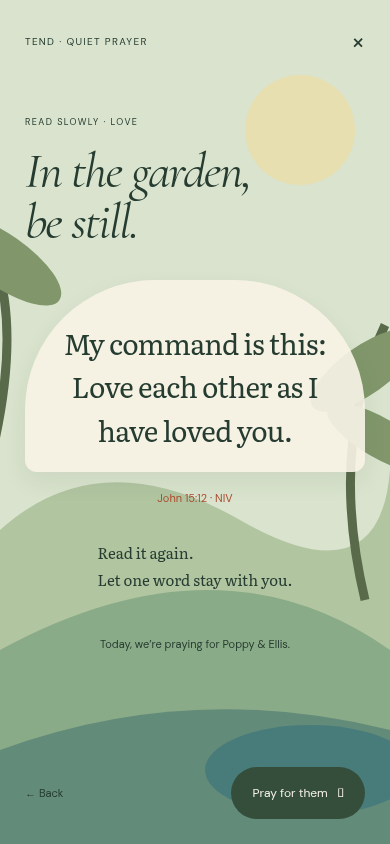
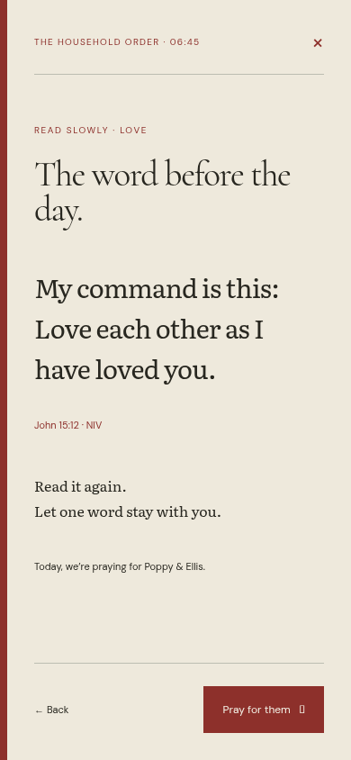
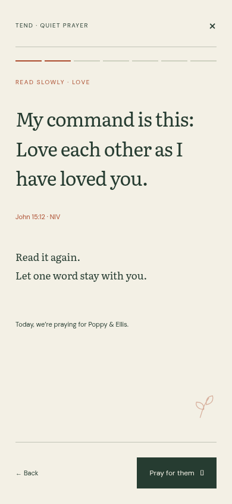
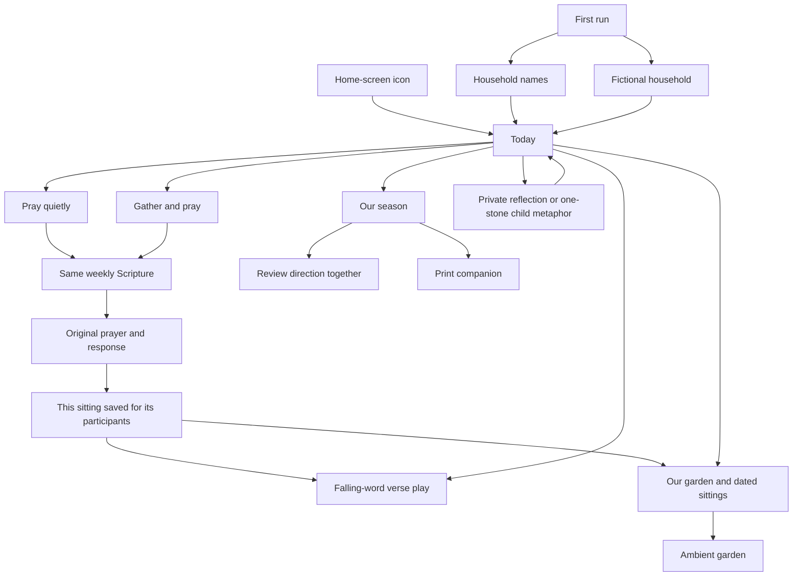

# Design direction — Studio B

## Discover

See DISCOVERY.md. Protect the quiet prayer typography, the falling-word puzzle, forgiving input and koi feeding. Repair the global day-completion flag, inconsistent Scripture wording, six-person assumptions, obscure navigation and rolling week. Replace compulsory stone-clearing for adults. Nothing here needs a performance economy.

## Research

Sources were read on 22 October 2026; this is desk research, not a claim to have used these products. Detailed evidence and limitations are in RESEARCH-PRACTICE.md and RESEARCH-PLAY.md.

| Source | Take | Reject |
|---|---|---|
| [Lectio 365](https://lectio365.com/) | A familiar pause, Scripture, response and yielding rhythm | A publishing operation or several obligatory daily appointments |
| [Pray As You Go](https://prayasyougo.org/) | A framework that leaves room for personal prayer | An audio-led session when this brief asks for silence |
| [Practicing the Way: Solitude](https://www.practicingtheway.org/solitude) | Brief stillness and a way to take the practice away on paper | Promising transformation through app completion |
| [Godly Play Canada](https://www.godlyplay.ca/about) | Open wondering; private responses count | Mandatory sharing, writing or a correct spiritual answer |
| [Retrieval Practice](https://www.retrievalpractice.org/faq) and [EEF](https://educationendowmentfoundation.org.uk/news/retrieval-practice-a-game-of-hide-and-seek) | Low-stakes recall with cues and another attempt | Claiming reconstruction proves memorisation |
| [Monument Valley](https://ustwogames.co.uk/our-games/monument-valley/) | A composed, hand-made place and generous touch | Copying impossible architecture or making prayer a puzzle |
| [Alto's Odyssey](https://www.landandsea.games/altos-odyssey) | A consistent landscape, light and silhouette | Endless play as the default ending |
| [Humane Product Design](https://www.humanetech.com/humane-product-design) | Cooperation, stopping well, neutral return after absence | Streaks, deprivation, guilty creatures and engagement targets |
| [Biblica permissions](https://www.biblica.com/permissions/) | Small verbatim NIV collection with acknowledgement; track counts | Adding a whole translation or paid-service dependency |

## Directions explored

### 1. A living garden

One illustrated landscape is the whole interface. Stones, seeds, pond and vineyard open the daily activities. Personal growth creates more life. It could be a strong children's place, but makes navigation depend on interpreting scenery and risks turning silent prayer into a waiting room for rewards. The spiritual director rejected the coupling of devotion and visual prosperity.

### 2. A household order of prayer

One sequence, almost a pocket liturgy: pause, read, pray, respond, end. Restrained near-black type, a margin ribbon and almost no illustration. It is the strongest bedside tool, but the child designer objected that play becomes a secondary worksheet. The ambient board and season have no natural home. Too narrow for the whole brief.

### 3. A household fieldbook — chosen

**Tend. Scripture, held together.** A quiet book with three places: Today, Our garden, Our season. Today opens directly to the household's one prayer; Quietly and Together are two sittings, with different participants, of the same Scripture. The garden gives a place to rest and look back; the season is a deliberate occasional review. The children get a full physical word game without first passing an adult practice.

This keeps the silence of direction 2 and the welcome of direction 1 without forcing one interaction to do both jobs. It costs some seamless animated continuity. That is the right trade: the practice sets the pace.

## The visual and interaction system

- **Illustration:** original vector cut-paper walled garden. An olive tree, terraced ground, a curved pond, climbing foliage and small koi. Uneven paths and layered botanical shapes, restrained fine hatching. It should feel like a gardener's illustrated fieldbook, not a game map. No stock photography or clip-art icons.
- **Type:** Cormorant Garamond for large, expressive editorial headings; Literata for Scripture and prayer; DM Sans for short controls. Self-hosted fonts, including fallbacks. Large reading type, modest line length, no tiny devotional copy.
- **Palette:** oat paper, forest ink, vermilion binding, warm ochre and muted sage. Night is blue-black paper, pale oat ink and softened terracotta; no full white flash. The season changes botanical accents rather than making prayer illegible.
- **Layout:** book-like masthead and section rules; an asymmetric daily spread on tablet, a clear reading order on phone. Open sections rather than a dashboard of equal rounded cards. One strong action, then optional invitations. Marginal labels, large type and genuine whitespace carry hierarchy.
- **Motion:** the garden has at most two slow ambient movements, never behind prayer. Feeding is directly caused by a tap. Word physics is user-invoked, not ambient. Reduced motion gives static garden and stationary shuffled word pieces. No confetti, sparkle or moving labels.
- **Sound:** none. Future spoken guidance can be deliberately invoked; no audio dependency now.
- **Touch:** 44 px minimum targets for main actions. Words accept drag, tap and keyboard. Free hints, repeat play and a clear close; never a timer or score. Completion names an activity, never a virtue.
- **Prayer:** a short threshold, the exact weekly verse, original prayer for today's pair, optional wondering, Amen. Still, self-paced steps; a full-text option for reading and printing. Prayer never auto-advances.
- **Confession:** private adult prompt, asking forgiveness, possible repair, then release. No answer is stored. Optional child's one-stone metaphor names an action rather than a feeling. It is not a condition for praying or playing.
- **History:** dated sittings and participants. A cultivated garden may accompany these memories, but no plant dies and no puzzle performance is labelled spiritual growth.

## Defaults deliberately rejected

| Default | Chosen instead | Why |
|---|---|---|
| Stock cards, grey canvas, purple gradient | Oat-paper editorial spread and one garden illustration | A distinct place with an attention hierarchy |
| Inter/system headings | Cormorant display, Literata reading, DM Sans controls | Reading and navigation have different jobs |
| Dashboard of completed habits | Two invitations to the same prayer; dated sittings | Dad's Amen must not finish the children's evening |
| Streaks and fading plants | A record that waits kindly | Absence creates no debt |
| Adult metaphor presented as confession | Actual private reflection and asking forgiveness | Handling stones cannot substitute for honesty |
| Difficulty menu as an entrance fee | All words fall by default; hints available | The children's stated favourite is the default |
| Six fixed people and index-based identity | Editable household with stable IDs | The foundation must admit other households |
| Account or browser hunt | Installable local-first book | From a home-screen icon to prayer in seconds |

## House skills

**abide-direction: adapted.** Keep the attention budget, still reading, coherent light, reduced motion and hand-made physicality. Replace the detailed vine/wind implementation and fixed palette with a quieter cut-paper fieldbook. Overturn mandatory multi-step garden work and the prohibition on another art style: this is a new coherent system, not another effect on the old scene. Do not adopt sound or decorative gold.

**product-review: kept, with one correction.** Keep outcome, few decisions, one clear next action, forgiving play, persistence, phone/night checks and cutting. Do not equate recorded frequency or puzzle success with faithfulness. Every sitting is separate and nobody is behind.

## Scope decisions before code

Use a direct family board now; personal boards feeding it remain backlog. No import of legacy data. Use an eight-week rotation with Monday boundaries and the same passage on Sunday. New devices can choose a believable fictional demonstration or a minimal household setup. Full prayer, play and saved records should remain available after an online visit without a backend. A protected hosted preview is not a substitute for local browser evidence.

## Addendum: rendered directions and visual craft

The addendum arrived after the direction commit and the first code pass. Implementation paused immediately. These are three actual 390 × 844 browser renders of the same 06:45 Scripture-reading state, made before resuming the build. The reproducible HTML study is beside them. They are direction studies, not screenshots passed off as finished software.

| 1. Living garden | 2. Household order | 3. Household fieldbook — selected |
|---|---|---|
|  |  |  |

The garden direction puts a literal landscape behind prayer and feels welcoming but competes with silent attention. The order direction is beautifully economical, but its permanent liturgical binding and heading make every moment feel like a formal service. The fieldbook gives the verse most of the page, quiet progress, one margin mark and a clear next action. It can also open into a garden without pretending that the garden is prayer. Keep the chosen direction; make its navigation and small-print controls larger than these exploratory studies to meet the new 48 px rule.

### Visual craft references

| Reference read | What it informs | What we do not copy |
|---|---|---|
| [Carle Museum: Artistic Process](https://carlemuseum.org/about/about-eric-carle/artistic-process) | Layering a small vocabulary of coloured shapes can make a consistent picture-book world. Our original SVG leaves, stones and fish use cut-paper silhouettes and sparse hatching. | No Carle character, palette, painted paper or composition is reproduced. |
| [V&A: William Morris and wallpaper](https://www.vam.ac.uk/articles/william-morris-and-wallpaper-design/) | Observe botanical shapes and repeat related forms; keep the relation between pattern and negative space. Our olive leaf and branch supply the whole family's visual vocabulary. | No Morris pattern; no dense ornament behind words. |
| [US Web Design System: Typography](https://designsystem.digital.gov/components/typography/) | Reading depends on measure, size, leading and hierarchy together. A serif can serve sustained adult reading. Keep prayer columns short, left aligned and unhurried. | A font name is not an accessibility claim. Do not shrink text to preserve a screenshot. |
| [Dyslexia Scotland: typed formats](https://dyslexiascotland.org.uk/dyslexia-friendly-typed-formats/) | There is no universal special font; spacing, plain forms and individual preference matter. Children's instructions use clear sans type, one instruction at a time; verse words stay large with generous targets. | Do not claim that a font solves dyslexia or decorate children's instructions with italics/caps. |
| [W3C contrast](https://www.w3.org/WAI/WCAG22/Understanding/contrast-minimum.html) and [resize text](https://www.w3.org/WAI/WCAG22/Understanding/resize-text.html) | Audit actual token combinations at day/night; allow 200% text with reflow. | Do not treat decorative low-contrast rules as accessible control outlines. |

Illustration is original SVG and CSS, consistently used on Today, Garden, Season and welcome. No external illustration assets or generative imagery. Font files are self-hosted; genuine SIL Open Font Licences are in public/fonts. No source artwork is embedded.

### One token system

One central tokens file supplies paper, ink, accent, muted, soft and elevated surfaces; display/reading/control type; spacing steps; square controls, organic illustration radii; one restrained panel shadow; fast press/slow ambient durations and the 48 px touch minimum. Night changes semantic colour values, not component structure or a separate screen stylesheet. Winter/spring/summer/autumn alter the garden's botanical accent, not contrast in reading. Secondary colours may be decorative only; text stays on audited surfaces. Day ink/paper is 10.38:1, accent/paper 4.81:1 and muted/paper 4.51:1. Night ink/paper is 11.80:1, accent/paper 6.93:1 and muted/paper 7.25:1. Recheck muted/accent against elevated surfaces; do not reduce their opacity.

### The shape of the whole

**Tap budget:** from an installed home screen, Today → Pray quietly (one tap) → Begin (two taps) shows the first line of this week's Scripture. Participant defaults remove a daily setup chore. Together follows the same two taps, with the option to adjust who is actually present. No account, tour, game or confession gate.

### States and transitions

- First run offers a tiny household setup and an obvious fictional demo. Empty history says there is room for a first page.
- An empty week has no missed-day counter and no grey debt. Returning after a gap opens the current prayer in the same welcome.
- Already prayed today records a sitting, never closes the day. The other sitting stays available and repeat prayer remains possible.
- Night uses the same semantic tokens. Reduced motion removes ambient motion and supplies stationary word play.
- Prayer advances only on a tap; finishing offers play or garden, with a quiet exit. Browser Back remains usable. Seasonal editing saves and returns to the board. Leaving a confession saves no content.
- At 200% text, reading grows and pages can scroll. A large-print word bank is preferable to forcing enlarged words back into a fixed-height physics canvas.

### Voice guide

Use plain British English and contractions that sound natural aloud. Address people warmly, without praise for app use. Give one short instruction at a time, especially in play. Say “practised”, never “mastered”; say “a sitting”, never “day complete”. No jargon, exclamation marks, guilt, spiritual grades or claims that a tap grants forgiveness. Silence is always a legitimate response.

### Proof plan before shipping

Capture all eight moments before/after at both sizes, by day/night. Walk the solo morning, the reading 7- and 9-year-olds after dinner, and a fresh household as proxy usability passes; explicitly distinguish these from interviews with the actual family. Measure the two-tap path, audit 48 px actions/contrast, check 200% reflow and reduced motion, then run the complete built site offline on a clean browser context. Physics and its CSS load only when play opens.
