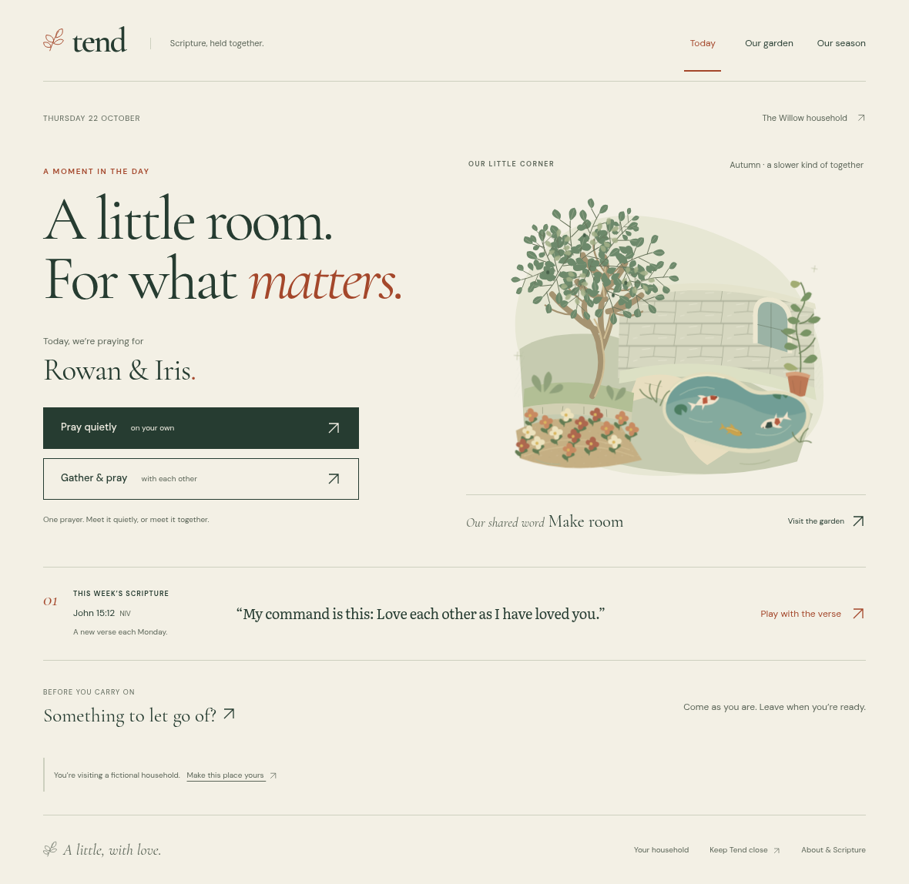
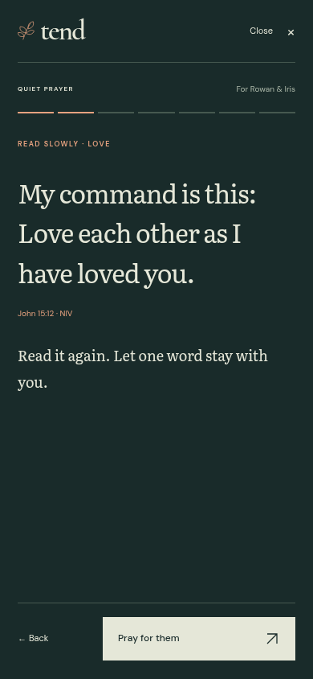

# Before and after

The before images are browser renders of the untouched shared base. The after images are the working built entry at 390 × 844 and 1180 × 820, by day and night. All eight moments have both sizes and both light settings. `00-today` supplies the new front door; `05-child` shows the optional stone alongside the adult treatment.

The final production pass captured 40images without a browser error; eight reading images were then refreshed after removing the browser's default outline on a programmatically focused non-interactive reading region. Keyboard actions retain their visible focus ring. The capture receipt is in after/capture-receipt.json; the last build's smoke receipt is FINAL-SMOKE.json one folder above.

| Moment | Phone day | Phone night | Tablet day | Tablet night |
|---|---|---|---|---|
| 1. Quiet morning prayer | [before](before/phone-day-01.png) · [after](after/phone-day-01.png) | [before](before/phone-night-01.png) · [after](after/phone-night-01.png) | [before](before/tablet-day-01.png) · [after](after/tablet-day-01.png) | [before](before/tablet-night-01.png) · [after](after/tablet-night-01.png) |
| 2. After-dinner verse play | [before](before/phone-day-02.png) · [after](after/phone-day-02.png) | [before](before/phone-night-02.png) · [after](after/phone-night-02.png) | [before](before/tablet-day-02.png) · [after](after/tablet-day-02.png) | [before](before/tablet-night-02.png) · [after](after/tablet-night-02.png) |
| 3. Sunday household prayer | [before](before/phone-day-03.png) · [after](after/phone-day-03.png) | [before](before/phone-night-03.png) · [after](after/phone-night-03.png) | [before](before/tablet-day-03.png) · [after](after/tablet-day-03.png) | [before](before/tablet-night-03.png) · [after](after/tablet-night-03.png) |
| 4. A glance in passing | [before](before/phone-day-04.png) · [after](after/phone-day-04.png) | [before](before/phone-night-04.png) · [after](after/phone-night-04.png) | [before](before/tablet-day-04.png) · [after](after/tablet-day-04.png) | [before](before/tablet-night-04.png) · [after](after/tablet-night-04.png) |
| 5. Clearing the ground — adult | [before](before/phone-day-05.png) · [after](after/phone-day-05.png) | [before](before/phone-night-05.png) · [after](after/phone-night-05.png) | [before](before/tablet-day-05.png) · [after](after/tablet-day-05.png) | [before](before/tablet-night-05.png) · [after](after/tablet-night-05.png) |
| 6. Looking back | [before](before/phone-day-06.png) · [after](after/phone-day-06.png) | [before](before/phone-night-06.png) · [after](after/phone-night-06.png) | [before](before/tablet-day-06.png) · [after](after/tablet-day-06.png) | [before](before/tablet-night-06.png) · [after](after/tablet-night-06.png) |
| 7. New season / board review | [before](before/phone-day-07.png) · [after](after/phone-day-07.png) | [before](before/phone-night-07.png) · [after](after/phone-night-07.png) | [before](before/tablet-day-07.png) · [after](after/tablet-day-07.png) | [before](before/tablet-night-07.png) · [after](after/tablet-night-07.png) |
| 8. First run | [before](before/phone-day-08.png) · [after](after/phone-day-08.png) | [before](before/phone-night-08.png) · [after](after/phone-night-08.png) | [before](before/tablet-day-08.png) · [after](after/tablet-day-08.png) | [before](before/tablet-night-08.png) · [after](after/tablet-night-08.png) |

## Chosen direction in use

| The daily spread, tablet | Quiet prayer, phone at night |
|---|---|
|  |  |

## Other evidence

- [Phone front door](after/phone-day-00-today.png)
- [Child stone, phone](after/phone-day-05-child.png) · [tablet](after/tablet-day-05-child.png)
- [Night physical word game](phone-night-physics.png) · [completion](phone-night-verse-finish.png)
- [Three rendered rival directions](../DESIGN-DIRECTION.md)

Reproduce the after matrix with `python scripts/capture-tend.py` against a production preview on port 4173. The game is photographed with words actually fallen; animation is disabled only for the instant screenshot. Reduced motion, touch, dragging, keyboard and enlarged text were tested separately. No image is a mock-up of a claimed working screen.
