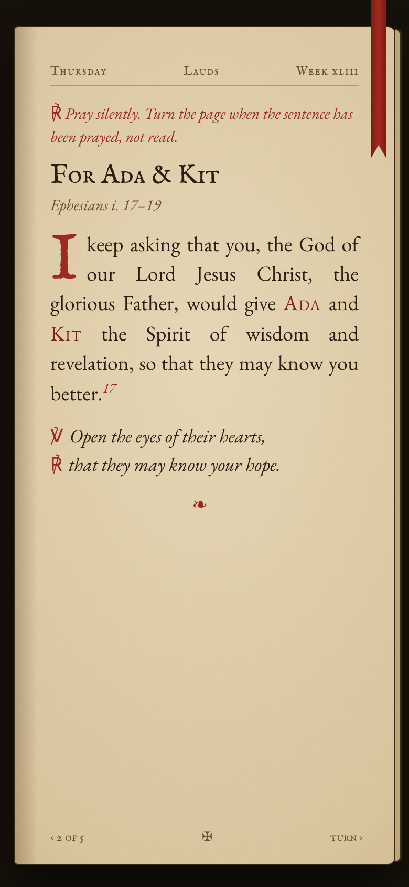
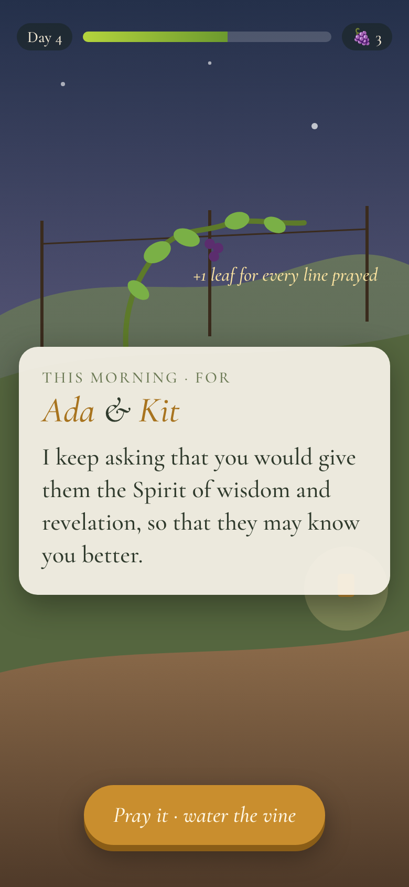
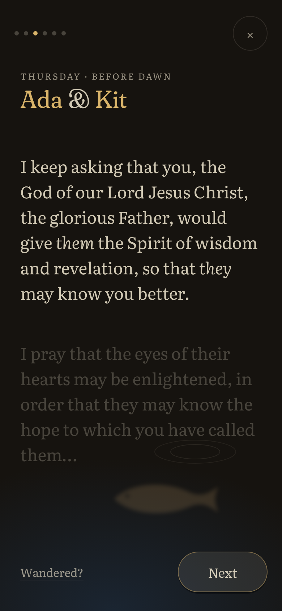

# Design direction: entry C — *Quiet Waters*

> "He leads me beside quiet waters, he refreshes my soul." Psalm 23:2 (NIV)

Written and committed before any product code.

## What we found (discover)

We read every doc in `docs/`, the code for every surface, and walked the app at 390 px and
1180 × 820, by day and at `?h=22`.

**Genuinely good; protect it**

- **The koi.** `SpineFish` is a remarkable piece of craft: weight, curiosity, shyness,
  depth, surfacing, feeding that each fish has to *notice*. Nothing else in the space
  looks like it. Children enjoy feeding them.
- **The verse puzzle.** The children's favourite (always the *Memory* cut). The physics,
  the "only the next slot is live" rule (recitation in order, not a jigsaw), wrong words
  bouncing back with no buzzer: all right. We port it nearly verbatim.
- **Pray's reading craft.** Literata, gold names, one thought at a time, the next showing
  faintly, Amen bringing the koi *up from beneath the paper*.
- **The content.** Fourteen Scripture prayers, each in three registers, a word per week,
  "I wonder…" questions, a breath prayer per word. Months of careful writing.
- **The stones as an idea.** Naming the thing in the way, physically putting it down.
  Children like the doing.

**Broken, or not landing**

- **Three doors and a fourth to join them.** Pond, Pray, Abide, Today, plus Flourish,
  Murmuration, Make, Labs, Admin. The join lives in `localStorage` and in the family's heads.
- **06:45 is bright.** Neither Pray nor the pond has a night palette. At `?h=22` the pond is
  still sunlit teal and Pray is cream paper. In a dark bedroom that is a torch in the face.
- **Hidden decisions with odd defaults.** Voice (Solo / Together / Kids), first person,
  "praying as": all chosen in a settings sheet, though the app could infer them from *who is
  in the room*.
- **Two daily practices.** Pray (5 min) and Abide (3 min) each ask for a daily sitting, each
  with its own world, its own "who's here" and its own record. Abide's many mechanics
  (patience, dropped seed, rich soil, garlands, watchtower) go undiscovered.
- **Confession that doesn't land for the adult.** In the client's words, the concept is more
  compelling than the doing: dragging stones doesn't make him reflect.
- **Looking back is an empty field.** A young vineyard is one vine in a large brown space.
- **One family, hard-coded.** Six names, indices into a fixed array, a rota that only works
  for six, one adult's personal board ("HYROX") as the family's board.
- **Small but real:** the week rolls seven days after creation, not on Monday; the prayer
  says "this morning" at night; the rota is random per device, so Dad's phone and the tablet
  disagree about who today's pair is.

## Research

| Source | What we take | What we reject |
|---|---|---|
| **Lectio Divina** | Read the verse slowly, then again, with one word lifted out. Silence after. | Long-form sessions; the four movements as labelled steps (we let the order carry it). |
| **Centering Prayer** (the "sacred word") | When the mind wanders, return *gently* with one word. The week's word becomes Dad's return word: *"Wandered? Come back with: See."* This is the direct answer to "my mind wanders". | Twenty-minute sits; it serves the 5-minute prayer, it doesn't replace it. |
| **The Ignatian Examen** | Its confession shape: stillness, review, sorrow, grace, resolve. The adult confession is a short examen, not a minigame. | The full daily evening Examen as a module (backlog: new disciplines). |
| **Breath prayer / the Jesus Prayer** | Two half-lines on the in- and out-breath to open the sitting (the content already exists per word). | A breathing exercise as the product. |
| **Practicing the Way** (Comer) | A *rule of life* as a trellis, not goals: the season board becomes a few family "we will…" practices, plus each person's word. | Curriculum, programmes, a course to complete. |
| **Godly Play** | "I wonder…" questions with no right answer; physical, slow handling of objects; trusting the silence. | Scripted adult explanation of the wondering. |
| **Lectio 365 / Lectio for Families** | The same order every day (Pause, Rejoice, Ask, Yield), so the practice becomes muscle memory. | Audio-first (sound is out this round). |
| **Pray as you go** | A threshold that marks the start of sacred time (their bell; our stilling water). | Audio. |
| **Hallow** | Craft and a real night mode for the bedside. | Streaks, challenges, leaderboards, celebrity voices, upsells, notifications. |
| **Duolingo** | Short sessions; *graduated difficulty for memory* (more blanks each round, then from memory). Delight on success. | Streak guilt, leagues, the owl's notifications, gems. |
| **Headspace** | One obvious next action; calm illustration; night content. | Course catalogues, paywalls. |
| **Finch** | Missing a day costs nothing; nothing withers. | Virtual pet economy. |
| **Monument Valley / Alto's Odyssey / Sky** | Light that follows the clock; play without words; *giving light to others* (Sky). Praying for someone raises *their* koi: you give, they rise. | Endless play, grind. |
| **Humane design** (Center for Humane Technology; Weiser's calm technology) | Clear stopping cues ("That's it. Amen."). Periphery, not centre. Paper where paper is better. No feeds, no badges, no notifications. | Variable rewards, autoplay, infinite anything. |

### Visual craft research

References inform the choices; no specific artwork, character or brand is copied.

| Reference | Area | What we take |
|---|---|---|
| Japanese koi and bird-and-flower painting and woodblock prints (the nihonga and *kachō-e* traditions; Hiroshige's night and moon scenes) | Illustration, colour | Water as negative space; a few shapes doing all the work; night as indigo with one warm light. Ripples drawn as print-like rings, not effects. |
| Indigo dyeing (*aizome*, shibori) and printed textiles | Colour, texture | The night palette: layered indigo rather than black, so the dark pond still has depth. The idea of a pattern that *accumulates* (lily pads over a season). |
| Illuminated manuscripts and Books of Hours | Type, colour | **Gold leaf is reserved for what is holy or meant.** Our rule: gold only for the names being prayed for, the place you are, a word placed correctly and a lotus that has opened. Rubrics: one quiet instruction in the margin. |
| Icons (the gold ground) | Colour | Gold as light rather than decoration: a warm gold (`#d9b46a`) at night, a deeper gold (`#87591a`) by day, so it still reads at AA. |
| Children's Bibles that treat light as meaning, and picture books with limited palettes and textured flat shapes | Illustration | Restraint: four or five colours per scene, warmth from light rather than saturation, humour and life from *behaviour* (a curious koi) rather than faces. No cartoon mascots. |
| Calm games (Alto's Odyssey's sky by the clock, Sky's giving light, Monument Valley's "every screen is a picture", koi-pond games) | Motion, colour | Time of day changes the whole world together; play needs no text; every screen should work as a picture on the wall. |
| **Literata** (designed for long reading on screens) | Type | The reading face for Scripture and prayer: high x-height, sturdy serifs that survive small sizes and dark mode, optical sizes. |
| Early-reader type research (single-storey *a* and *g*, generous spacing, larger sizes, short lines) | Type | The children are about 7 and 9 and can read. We keep Literata but set it larger (+15%), with wider spacing and lines of six to nine words. A pre-reader face (SIL's Andika) is backlog, for the youngest. |
| Dark-mode reading (halation, glare) | Type, colour | At night: never pure white (parchment at 88%), slightly lighter weight, +0.01em tracking, line-height 1.55, no full-brightness elements, and gold dimmed. |
| **Fraunces** (a soft, "wonky" old-style display serif) | Type | The words in the water and the headings: warm and hand-made rather than corporate. Its SOFT axis rounds the serifs so the word sits *in* water. |
| Real ponds through the year (maple leaves in autumn, ice at the margin in winter, blossom in spring, lotus in summer; koi lie deep and slow in the cold) | Colour, season | One seasonal detail on the water at a time, and the koi behave truthfully: fewer at the surface in winter. |

### Illustration method, and licences

Everything is **drawn in code**: canvas for the water, koi, lily pads, lotus, stones,
flowers and leaves, and CSS for paper and controls. There are no images, clip art,
stock photography or icon sets, so every moment is drawn the same way.

- Koi: `src/SpineFish.js`, adapted from akeatk/fish-pond (MIT), extended in this repo.
- Physics for the puzzle and stones: matter-js (MIT); the stones use a small custom
  throw-and-sink instead.
- Type: Fraunces and Literata (SIL Open Font License 1.1), self-hosted through
  `@fontsource-variable`. The style tiles also use EB Garamond, IM Fell English SC and
  Cormorant Garamond (all SIL OFL 1.1) to render the losing directions.
- Scripture: NIV (Anglicised): the fourteen memory verses plus Psalm 139:23–24, Micah
  7:19 and 1 John 1:9 in confession. That is fewer than 30 verses, well inside Biblica's
  General Use Guidelines, and the acknowledgement is shown in the app.

## Directions explored

### Direction 1: *The Book of Hours*: a page by the bed

**Idea:** the product is a beautifully typeset prayer book. One spread per day: the
verse, today's names, the prayer, a rubric in red. A ribbon marks today. The
children's puzzle is a "workbook" chapter at the back. A weekly card prints for the
bedside and the fridge, and a lock-screen image carries the verse. The pond survives
only as the book's cover.

**Structure:** linear, like a breviary: Today → the week → the season (front matter).
**Look:** letterpress on warm paper, rubrics in vermilion, Literata and EB Garamond,
no illustration. **Strength:** the best possible 06:45; honest about paper. **Weakness:**
the children would not choose it, the glance moment is a book lying open, and it throws
away the most distinctive thing in the repo (the koi).

### Direction 2: *The Vineyard*: a world that grows

**Idea:** Abide's world becomes the whole app. The home is the hillside; each sitting
(prayer, puzzle, clearing) plants, waters or prunes. The board is the vineyard's sign.
Looking back is walking the rows. **Structure:** a game map with stations.
**Look:** Abide's painterly field, sky by the clock. **Strength:** the most "game" for
children; rich long-term accumulation. **Weakness:** it makes prayer a mechanic in a
growing-game. That is exactly what the client fears ("help that respects the practice
rather than gamifying it"). It carries Abide's undiscovered mechanics forward. And the
art doesn't yet have a good young-garden state.

### Direction 3: *Quiet Waters*: one pond, everything happens on it

**Idea:** one place. The pond is the home, the idle screen and the record. The family
word lies in the water. Each person is a koi, with today's names drawn beside theirs.
Every practice begins *from* the water and returns *to* it:

- **Pray** stills the water and it becomes paper. At night it becomes dark paper. You pray
  for today's pair; at Amen *their* koi rise.
- **Play the verse**: the week's verse falls apart on the page and the children put it
  back, round by round, until it's by heart.
- **Into the deep**: confession is laying stones down into the water. *"You will … hurl
  all our iniquities into the depths of the sea"* (Micah 7:19). For an adult, a short
  examen comes first, and then a single stone. For a child, it's the physical joy of
  throwing a stone into a pond and watching it sink. (Revised after critique; see below.)
- **Looking back**: the pond fills over the season. A lily pad for each week; a lotus
  opens when the week's verse is learned by heart. Clear water at the start of a season,
  a full pond at the end.
- **The season board**: each person chooses their own word; the family chooses its word
  together. The family word lies in the water. Tap your own koi and it shows your word.

**Structure:** a home and four short sittings that open over it and close back into it.
**Look:** the koi pond, re-lit by the clock and the season, with prayer on still paper.

## Style tiles

The same screen in each direction: **06:45, Dad's phone, praying for Ada and Kit**, the
second thought of the prayer, rendered at 390 px. The HTML sources are in
`directions/src/` and the renders in `screens/directions/`.

<table><tr>
<td align="center"><br><b>1 · The Book of Hours</b></td>
<td align="center"><br><b>2 · The Vineyard</b></td>
<td align="center"><br><b>3 · Quiet Waters</b></td>
</tr></table>

(Also as one image: `screens/directions/side-by-side.png`.)

What the tiles show that the words didn't:

- **The Book** is the most beautiful page, but at 06:45 it is a lit page in a dark room.
  A book needs light, so it can never really be night paper: dimming parchment only makes
  it muddy. Its rubrics ("turn the page when the sentence has been prayed, not read") are
  the best single line of instruction we wrote. That idea survives as *Wandered?*
- **The Vineyard** puts a meter, a counter and "+1 leaf for every line prayed" above a
  prayer. Seeing it rendered settles the argument: it makes prayer a mechanic, which is
  what the client asked us not to do. The gold button also shouts at a sleeping house.
- **Quiet Waters** is the only one that is genuinely dark at 06:45. Gold appears on the
  two names and the place you are, nowhere else. The next thought waits faintly below,
  the water and a koi sit under the paper, and the only controls are a way back to
  attention (*Wandered?*) and *Next*.

## The decision

**Quiet Waters wins.**

- It keeps the two things the family already loves: the puzzle, and the koi you can feed.
- It answers "one product" literally. There is one world, and every practice opens from it
  and closes back into it.
- It serves the glance by its nature. An idle pond with the family's word in it *is* the
  glance.
- It finds better homes for the ideas that were struggling. The stones go into the water,
  where letting go is the natural metaphor; the field was not. Looking back becomes a pond
  that fills, where an empty vineyard had nothing to show early on.

**What we take from the losers:** from *the Book*, prayer on still paper with a real night
palette, the same order every morning, and a printed weekly card for the bedside. From
*the Vineyard*, accumulation over the season and physical play for the children.

**Why the Book lost:** the children wouldn't choose it, and it discards the koi.
**Why the Vineyard lost:** it turns prayer into a growing game, and its art has no good
"young" state.

## What the bench argued about (and what changed)

Before committing, two of us critiqued the draft independently: the spiritual director
and the children's game designer. They disagreed with the draft, and on one point with
each other.

| Issue | Spiritual director | Game designer | Decision |
|---|---|---|---|
| **Adult confession** | Reflection must come *before* the gesture: ask for light, review a concrete day, silence, name it to God, then **one** stone, opened from the hand. God is the one acting ("He casts it into the depths", never "let it go"). Keep it out of 06:45. Make it an evening sitting, suggested on Saturday night before Sunday. | (Not their seat.) | **Adopted in full.** "Holding the stone is the reflection" was our mistake: the client told us the doing never produced the reflecting. |
| **Children's confession** | No typed or preset sin words, which become labels a child wears. Parent-led. Assurance spoken aloud, naming Jesus. "Nothing comes to mind" must be allowed. Add saying sorry to someone. | Make it physical: the puzzle's fling, a heavy stone, a splash, rings, the koi scattering and returning, a haptic thud, clear water at the end. No typed stones (blaming, the keyboard covers the pond). About three stones, never hitting a koi. | **Both, merged.** Stones carry no words. A grown-up reads one gentle question, and each child chooses **a stone** ("sorry", whispered to God) **or a flower** ("thank you", from the Examen's gratitude), so nobody has to find a sin. One each, thrown with real physics. A parent reads the assurance aloud, then: "Is there someone to say sorry to?" |
| **Koi at Amen** | Risks "I made her fish come up". Every Amen should end the same; in the morning, hold a few seconds of silence first. | Amen should flow straight into play. | **Kept, but quieter.** The koi that rise are always the people prayed for, at every Amen, so nobody earns them. The solo morning holds three seconds of still dark page first. The children's Amen offers *Play the verse*. This is the one point where we overrule the director: it is the client's most loved moment. |
| **Pads and lotuses** | One pad per week *prayed* is a streak dressed as a pond. Counts of prayer are a ledger. | The lotus should open when the household says the verse *together*. | **Adopted.** One pad for every week of the season, whatever happened that week. A lotus opens when the verse is said by heart. "Looking back" shows verses known by heart and the words, never prayer counts. |
| **Wandering mind** | The return word on every card becomes decoration. Show it on a tap. | — | **Adopted.** "Wandered?" is a quiet link on each card after the first; it shows the word and the breath prayer. Nothing is counted. After the verse is read twice there are 20 seconds of silence. |
| **The home** | — | A child pokes the water before reading a button. Feeding is always on. The verse lies on the water, and touching it starts the play. Play must not be the price of praying. | **Adopted.** Two equal actions on the pond: *Pray* and *Play the verse*. Feeding works everywhere on the water. Tapping your koi shows your name and your word. |
| **The puzzle** | — | The Memory cut drops the same words every time, so replaying teaches five words. The last round must be honest (the verse hidden, first letters as stepping stones, say it aloud, tap to check). Spread the levels over the week. Show turns by koi colour. Support several fingers at once. Don't lose the old "play the prayer with our names" round. | **Adopted.** Different words fall each round. Four steps over the week (*Some words* → *More words* → *Every word* → *By heart*), and the app remembers where you got to. In *By heart* the verse is hidden and tapping each first letter checks it. The live slot glows in the colour of whoever's turn it is. Several drags can run at once. *Today's prayer, with our names* stays as a second game. |

**What we cut** (Abide's sow-grow-gather, the vineyard, Flourish, Murmuration, Today, Labs,
Admin and the separate `/make/`) is recorded with reasons in `DIGEST.md`. The old URLs
redirect into the one app, so nothing the family has bookmarked breaks.

## The product, moment by moment (summary)

| Moment | What happens |
|---|---|
| 1 · 06:45 Dad | The phone opens on a night pond. One tap: **Pray**. The water stills into dark paper. Three breaths with the week's breath prayer. Read the verse twice, then 20 seconds of silence. Pray for today's pair one thought at a time; "Wandered?" gives back the week's word. Bless them, then Amen, a held silence, and their koi rise under the dark page. About five minutes. Silent by design. |
| 2 · After dinner | The tablet; tap who's here. Simple words; each card shows whose turn it is to read aloud. An "I wonder…" question, the blessing together, Amen: koi rise, feed them. Then **Play the verse**: the puzzle, Memory cut first, more words each step through the week, until it's by heart. **Play** is also on the pond itself, never locked behind praying. |
| 3 · Sunday | Everyone. The Lord's Prayer, each person named in a blessing, the week's verse said together from memory, and a look back at the week. The week turns on Monday morning; the new prayer is a small surprise. |
| 4 · A glance | The idle tablet: the pond with the family's word, the week's verse and today's names on the water. The controls fade away after a minute. The screen can be kept awake. |
| 5 · Clearing the ground | **Into the deep**, suggested on Saturday evening. For an adult: ask for light, a concrete look back over the day, silence, name it to God, then one stone opened from the hand. "He casts it into the depths." 1 John 1:9 as assurance, and one small act of repair. For children, led by a grown-up: a gentle question, then a stone (sorry) or a flower (thank you) each, thrown into the pond with real physics, the assurance read aloud, "Is there someone to say sorry to?" Nothing is typed or stored. |
| 6 · Looking back | The pond fills over the season: a lily pad for every week, a lotus for each verse said by heart. **This season** gives the human sentences: the words we chose, the verses we now know by heart, and the lines written in the morning. Never prayer counts. |
| 7 · New season | Each person picks a word; the family picks its word and a few "we will…" practices. Last season is kept in a book of seasons. |
| 8 · First run | A clear pond and two doors: *Set up your household* (names, grown-up or child, a koi each) or *Look around with an example family*. A link carries the household to a second device, and the rota is computed from the date, so both devices agree on today without sync. |

## The visual and interaction system

- **Illustration:** the existing vector koi (procedural, hand-tuned shading), lily pads
  and lotus, plus new painted stones (radial gradient form, rim light, contact shadow).
  The water is painted, never photographic. No icons beyond a few drawn glyphs. People
  are their koi colour and their name; no avatars.
- **Type:** *Fraunces* (variable; soft, warm optical sizes) for the words in the water and
  for headings. *Literata* for everything read: Scripture, prayers, labels. Literata is
  designed for long reading on screens, generous at child sizes. Two families, self-hosted
  so they work offline. Body type is fluid: ~22 px on a phone and ~30 px on the tablet,
  larger when children are present.
- **Palette (by clock and season):** water at *dawn* (pearl and rose over jade), *day*
  (clear jade to deep teal), *dusk* (amber light on teal) and *night* (ink-indigo, moon
  caustics, koi seen by lantern). Paper is warm cream by day and *night paper* (`#16130f`
  with parchment text at 80%, no pure white) by night, chosen by the real clock (sunrise and
  sunset approximated by month), previewable with `?h=`. Season shows on the water: autumn
  leaves, winter's thin ice at the margin, spring petals, summer lotus. **Gold is reserved
  for meaning:** the names being prayed for today, a word placed correctly, a lotus that
  has opened.
- **Motion, and its attention budget:** the home pond has the koi, one wind-driven
  shimmer and the pads, and nothing else. While anything is being *read*, nothing moves
  except what the reader does. No confetti, no particles for sparkle, no bouncing UI.
  Transitions are the water stilling into paper and the paper sinking back into the
  water, about 600 ms, eased out. Reduced motion: no koi movement, still water, every
  sitting still works.
- **Sound:** none, by the client's answer. Where it would go later is in `PITCH.md` (a bell
  at the threshold, the verse read aloud for pre-readers).
- **Touch and feel:** large targets (≥ 48 px; ≥ 64 px for children). A press sinks the
  element by 2 px into the water's shadow, rather than scaling or flashing. On Android a
  10 ms haptic tick when a word snaps home, a stone touches the water, and on Amen. Nothing
  rewards speed. The long-press menu is switched off over the water, so holding a stone
  or a word never brings up Android's copy menu. Several fingers can drag at once, so
  three children can share the tablet.

## Design tokens

Every token lives in one file, `src/app/tokens.css`, and every screen uses it.

- **Roles, not colours.** Tokens are roles (`--paper`, `--ink`, `--ink-2`, `--gold`,
  `--line`, `--slip`, `--on-water`, `--shadow`), plus type (`--font-display`,
  `--font-read`, a fluid size scale `--fs-*`, `--lh-*`), space (`--s1`…`--s8`, a 4 px
  base), radius (`--r-s`, `--r-m`, `--r-l`, `--r-pill`), touch (`--tap: 48px`,
  `--tap-child: 64px`) and motion (`--ease`, `--t-quick`, `--t-move`, `--t-slow`).
- **Day and night are two settings of the same tokens.** The root element carries
  `data-light="dawn|day|dusk|night"`, worked out from the real clock and the month, or from
  `?h=`. Each value only reassigns the role tokens. There is no second stylesheet, and no
  component knows what time it is.
- **The canvas reads the same tokens.** The pond painter takes its water palette from the
  same light value, so the paper and the water always change together.
- **Text size** is one multiplier (`--text-scale`, 1 to 2) applied to the type scale, so
  200% is a token change, not a layout.

## Map of the product

```
 Home-screen icon
      │  tap 1
      ▼
 ┌─────────────────────────────────────────────────────────────┐
 │  THE POND  (home; also the idle screen after a minute)     │
 │  family word · week's verse · today's names on the koi     │
 │  tap water = feed · tap a koi = their name and word        │
 └─────────────────────────────────────────────────────────────┘
   │ tap 2: Pray      │ Play the verse   │ Into the deep   │ This season      │ ⚙
   ▼                  ▼                  ▼                 ▼                  ▼
 Who's here?*       PLAY               INTO THE DEEP     THIS SEASON        Settings
   ▼                verse: 4 steps      adult: examen,    board + words,     household,
 SITTING            or today's prayer   one stone         what's taken       this device,
 still → verse →    with our names      with children:    root, book of      the week's prayer,
 prayer… → Amen     (puzzle)            stone or flower   seasons            another device,
   │  (children) ──▶ PLAY                each                ▼                print the week,
   ▼                                                      NEW SEASON         about and NIV
 back to the pond (every room closes back into it)

 First run: WELCOME ─▶ set up the household ─▶ the pond
            or "Look around with an example family" (= ?demo=1)
 * Who's here is asked once; after that it's remembered per device and time of day,
   and shown as a small "Praying: Dad · change" on the first card.
```

**Taps from the home-screen icon to the first line of today's prayer: two.** Icon, then
*Pray*. The sitting opens straight onto its first words: today's names and the week's
breath prayer, which flows into the verse. The first time a device is used, *Who's here?*
adds one tap, and is then remembered.

## Every state

| State | What it looks like |
|---|---|
| First run | A clear pond with one koi. "Quiet Waters" and one line. Two doors: *Set up your household* and *Look around with an example family*. |
| Empty week (new household or new season) | No lily pads yet; the board says "This season begins today." Nothing reads as missing. |
| Already prayed today | The slip says "Dad prayed for Ada and Kit this morning." *Pray* stays available, now quieter, for the next person; the children's evening sitting opens with "Dad prayed for you this morning. Now it's our turn." |
| Night | Night water, night paper, dimmed gold. The home and every sitting change together. |
| Returning after a gap | "Welcome back." and today. Nothing mentions the gap; every week still has its lily pad; nothing withers. |
| Sunday | The pond reads "Sunday · all of us"; the sitting is the household's. |
| Saturday evening | *Into the deep* is gently offered on the slip ("Saturday evening: a time to put things down"). Other days it is a quiet link. |
| End of a season | Two weeks before the season's end, the slip offers "Look back, and choose next season's words." |
| Transitions | The water stills into paper (paper rises 12 px and sharpens out of a blur, 600 ms, eased out), and the paper sinks back into the water when you close. Under reduced motion it is a plain cross-fade. |
| Reduced motion | Still water, koi resting, no rises, the puzzle's tiles laid out instead of falling. Everything still works. |

## Accessibility and small hands

- **Contrast:** every text role is AA or better in both settings (checked by script and
  recorded in `DIGEST.md`). By day the word in the water is deep-teal ink, not white on
  pale water; at night it is parchment.
- **Targets:** 48 × 48 px minimum; 64 px on children's screens (faces, the puzzle's tiles,
  the stones).
- **Reduced motion** is respected everywhere (see above).
- **200% text:** sizes are in `rem` × `--text-scale`; layouts wrap and scroll rather than
  clip. A text-size control is in Settings.
- **Children's screens:** one instruction, under ten words, plain words ("Put the words
  back."), and their own names and colours as the way to find themselves.

## Fast on an ordinary Android tablet

- The first screen is HTML and type, painted immediately. The pond canvas and koi load
  next, as their own chunk.
- The puzzle (matter-js) and *Into the deep* load only when they are opened.
- Fonts are self-hosted Latin subsets. A service worker caches the app after the first
  visit, so later opens are instant and offline.
- The pond caps itself at device-pixel-ratio 2 and redraws only what moves. While a
  sitting is open over it, it pauses.

## Voice guide

- **Speak like a quiet friend at the kitchen table.** Short sentences, plain British
  English (colour, favour, Mum).
- **One instruction at a time.** For children, under ten words.
- **Never** use exclamation marks, "great job", "streak", "don't break", "you missed",
  "unlock", "level up" or "oops". Never guilt, never hurry.
- **After a gap:** "Welcome back." Nothing else about it.
- **God acts; the app doesn't.** "He casts it into the depths." "God heard you." Never
  "you completed".
- **Scripture is quoted exactly**, with its reference. Everything around it is plain.
- **Labels are verbs or plain nouns:** Pray, Play the verse, Into the deep, This season,
  Done.
- **People by the household's own names.** The children see "Dad" and "Mum".

## Defaults we rejected

| The default | What we chose instead | Why |
|---|---|---|
| A home screen of cards or tiles | The pond, with one obvious action on it | The home should be a place, not a menu; and the idle screen should be the same place. |
| Bottom tab bar | One door (the pond) and sittings that open and close over it | Tabs say "app with sections"; we want "a place you visit". |
| Inter or system type | Fraunces + Literata, self-hosted | Prayer deserves a reading face; the water deserves a soft display face. |
| Grey or white UI, purple accent | Water and paper that follow the clock; gold only for meaning | Colour should tell you the time of day and what matters. |
| Settings for voice, person, mode | Inferred from *who's here* (one adult: "I", silent; children: simple words, turns to read aloud; everyone: Sunday) | Decisions before value are a cost; the room already knows the answer. |
| Streaks, badges, points | A pond that fills with pads and lotuses over a season, and never withers | Contribution, not performance; a missed day costs nothing. |
| Push notifications | A home-screen icon, an idle tablet that shows today, and a printable weekly card | Calm technology: in the periphery, not interrupting. |
| Confetti on success | The verse turns gold; koi rise | Celebration that means something. |
| Random rota per device | A rota computed from the household and the week | Two devices agree on today with no sync. |
| Splash screen and onboarding carousel | A clear pond with two doors | First run should already be the product. |

## House skills

- **`abide-direction`: adapted.** We keep its core: one continuous world, light by the real
  clock, gold only for meaning, the attention budget, stillness while reading, holds after
  key moments, reduced motion, and the director's checklist. We overturn its subject: the
  world is now *water*, not the field and vineyard, and its specific palette and the "one
  wind" machinery are replaced by the water's own shimmer and current. The checklist's
  "night, season, phone" test stays mandatory.
- **`product-review`: kept**, with two tests added that came from this brief: *the 06:45
  test* (half awake, in the dark: does anything here make me think about the app instead of
  the people I'm praying for?) and *the child-alone test* (a seven-year-old with no adult:
  can they get from the pond to the puzzle and back?).
